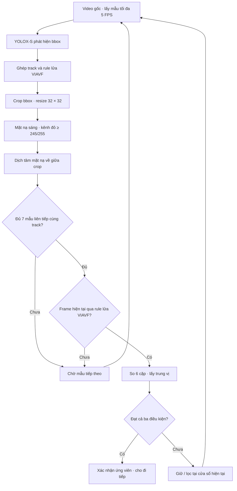

# Thuật toán lọc ứng viên lửa trong hầm gửi xe

Module Python thử nghiệm nhận diện lửa nhỏ, lửa lớn và giảm báo nhầm do đèn xe hoặc vùng phản xạ. YOLOX tìm vùng nghi có lửa, bản mô phỏng rule lửa VIAVF xét ứng viên, sau đó bộ lọc theo thời gian quyết định cho đi tiếp. Đầu ra phục vụ bước VLM hoặc phát cảnh báo trong hệ thống tích hợp.

## Luồng hoạt động



Lịch sử bắt đầu khi có track. Quyết định xác nhận chỉ được xét ở frame đã qua rule VIAVF. Khoảng cách hai mẫu lớn hơn 0,31 giây làm bắt đầu cửa sổ mới. Bảy mẫu ở 5 FPS trải dài khoảng 1,2 giây.

Rule lửa mô phỏng dùng confidence từ 0,25, hai cạnh bbox từ 9 px, dwell 1 giây và biến động bbox trong cửa sổ 1 giây. ROI camera, lịch hoạt động và VLM của hệ thống triển khai cần xử lý ở bước tích hợp.

### Ba điều kiện xác nhận

| Phép đo | Công thức và mục đích | Ngưỡng |
| --- | --- | ---: |
| Biến dạng vùng sáng | 1 trừ IoU của hai mặt nạ đã căn tâm. Giảm ảnh hưởng nguồn sáng chỉ dịch chuyển. | ≥ 0,10 |
| Co nở diện tích bbox | Trị tuyệt đối logarit tự nhiên tỷ lệ diện tích hai bbox, dùng tọa độ gốc. | ≥ 0,067 |
| Độ mượt crop | 1 trừ độ lớn Laplacian trung bình trên ảnh xám 0–1, chặn dưới tại 0. Giảm ca đèn quét qua nền nhiều cạnh sắc. | ≥ 0,85 |

Lấy trung vị trên sáu cặp. Với độ mượt, mỗi cặp lấy trung bình điểm hai crop. Ngưỡng diện tích tương đương tỷ lệ diện tích lớn hơn/nhỏ hơn khoảng 1,069. Ngưỡng độ mượt tương đương điểm cạnh tối đa 0,15. Cấu hình ở [cau_hinh.json](cau_hinh.json).

Crop 32 × 32 giúp so ảnh cùng kích thước và giảm chi phí xử lý. Lựa chọn này chưa được thử đối chiếu với nhiều độ phân giải. Các bbox nhỏ cũng được kiểm tra vì bộ lọc diện tích cũ từng để lọt nhiều đèn nhỏ.

## Tính năng

- Chạy YOLOX trực tiếp từ checkpoint hoặc phát lại JSONL có bbox và track.
- Hiển thị cửa sổ OpenCV bằng `--show`, dừng bằng Q hoặc Esc.
- Xuất MP4 H.264 bằng `--output`, có bbox, ID track, timestamp và trạng thái lọc.
- Kết hợp hiển thị và xuất video cùng lúc.
- Cung cấp `run_video()` và `FireVideoFilter.update()` cho ứng dụng Python.
- In số frame, số quyết định từng trạng thái và thời điểm ứng viên đầu tiên đi tiếp.

MP4 dùng nhịp lấy mẫu tối đa 5 FPS, thêm thanh trạng thái và bỏ âm thanh. Nếu dừng xem bằng Q/Esc hoặc đóng cửa sổ, module hoàn tất video đến frame đã xử lý. Chọn đường dẫn MP4 mới cho mỗi lần xuất.

## Cài đặt

Cần Python 3.10 trở lên.

```powershell
git clone https://github.com/chinh5712ivy/fire-algorithm.git
cd fire-algorithm
python -m pip install -r requirements.txt
```

Cài FFmpeg có bộ mã hóa libx264 và đặt trong PATH để xuất MP4. OpenCV cần có giao diện để dùng `--show`.

Để chạy YOLOX, cài thêm PyTorch/torchvision tương thích thiết bị và YOLOX từ [Megvii YOLOX](https://github.com/Megvii-BaseDetection/YOLOX). Checkpoint thử nghiệm là `yolox_s_fire_smoke_v8_mosaic09.pth`, kiến trúc YOLOX-S hai lớp, ID 0 là fire và ID 1 là smoke. Cung cấp checkpoint riêng qua `--checkpoint`. Các video và báo cáo dùng checkpoint này. Checkpoint được quản lý riêng với repo.

## Chạy module

### YOLOX trực tiếp, hiển thị và xuất video

```powershell
python -m fire_video "D:/du_lieu/video_goc.mp4" --checkpoint "D:/models/yolox_s_fire_smoke_v8_mosaic09.pth" --show --output "outputs/ket_qua.mp4"
```

### Phát lại trace đã lưu

```powershell
python -m fire_video "D:/du_lieu/lua.mp4" --trace "examples/garage_hand_flame.jsonl" --show --output "outputs/lua_nho.mp4"
```

Trace ví dụ thuộc video `video/for_test/lua.mp4` đã dùng trong thử nghiệm. Phải cung cấp video gốc tương ứng. Mỗi dòng trace có `timestamp` theo giây, `frame_size` theo thứ tự rộng/cao và danh sách `fire`. Mỗi đối tượng cần `track_id`, `bbox=[x1,y1,x2,y2]` và `viavf_rule`. Module kiểm tra kích thước và timeline.

Bỏ `--show` để chỉ xuất file. Bỏ `--output` để chỉ xem. Lệnh `python -m fire_video --help` liệt kê tùy chọn.

### Gọi từ Python

```python
from pathlib import Path
from fire_video import run_video

summary = run_video(
    Path("video_goc.mp4"),
    trace=Path("trace.jsonl"),
    output=Path("ket_qua.mp4"),
    show=True,
)
print(summary)
```

Nếu đã có bbox/track, tạo một `FireVideoFilter` cho mỗi luồng rồi gọi `update(frame, timestamp, tracked_rows)` một lần cho mỗi mẫu. Frame là ảnh BGR của OpenCV, timestamp tăng dần. Mỗi row cần `track_id`, `bbox` và `viavf_rule`. Lịch sử tích lũy từ row hợp lệ, còn chỉ row có `viavf_rule == "pass"` tạo quyết định. Dùng instance mới khi đổi video hoặc reset timestamp.

## Kết quả test mới nhất

### Các lượt trên bộ phát triển

| Phiên bản | Clip lửa được nhận | Clip âm được loại |
| --- | ---: | ---: |
| Bộ cũ, diện tích 0,3% / IoU 0,85 / 3 giây | 14/14 | 2/11 |
| Yêu cầu mẫu liên tiếp | 14/14 | 4/11 |
| Thêm thay đổi vùng sáng và kích thước bbox | 14/14 | 8/11 |
| Thử vùng sáng căn tâm và thay đổi độ sáng | 14/14 | 8/11 |
| Biến dạng sau căn tâm và thay đổi diện tích | 14/14 | 10/11 |
| Thêm kiểm tra cạnh sắc, bản cuối | **14/14** | **11/11** |

25 clip này tham gia chọn ngưỡng. Khi giữ riêng từng nhóm cảnh rồi chọn lại ngưỡng trên nhóm còn lại, quy trình đạt **13/14 clip lửa và 8/11 clip âm**. Một số nhóm có thông tin cảnh tương đồng đã được ghép, còn thông tin camera của các clip khác chưa đầy đủ.

Thời điểm xác nhận trung vị tăng từ **2,2 lên 2,6 giây** tính từ đầu clip. `media (6).mp4` tăng thêm **7 giây**. `media (13).mp4` chỉ được xác nhận ở **10,0 giây**, cuối clip. Đã đối chiếu trực quan bbox đầu tiên của 14 clip lửa.

### Clip bổ sung sau khi chốt cấu hình

| Dữ liệu | Kết quả |
| --- | --- |
| Một clip lửa nhỏ trong hầm | Đúng vùng lửa ở 1,6 giây, so với 1,4 giây của bộ cũ. |
| Ba clip âm trong hầm | Loại đúng 3/3, so với 2/3 của bộ cũ. |
| Video công khai xe máy cháy trong hầm | Đúng vùng lửa ở 64,4 giây, đồng thời vẫn nhầm cửa sáng ở 58,6 và 66,2 giây. |
| Video công khai ô tô cháy ngoài trời | Đúng vùng lửa lớn ở 1,2 giây. |

Một clip hầm bổ sung có nền camera tương tự bộ phát triển. Hai video công khai là ca kiểm tra lửa lớn trong cảnh khác bộ phát triển.

JSON tự động của clip xe máy cháy ghi ứng viên đầu tiên ở 66,2 giây trong khoảng đánh giá 66–93 giây. Bbox đó khoanh cửa sáng. Kết luận đúng vùng lửa dựa vào kiểm tra trực quan ở 64,4 và 67,0 giây, lưu trong [spatial_review.json](reports/spatial_review.json).

Xem [kết quả từng lượt và clip phát triển](reports/ket_qua_phat_trien.json) và [kết quả clip bổ sung](reports/ket_qua_doi_chieu.json).

## Video kết quả và mô phỏng

| Nội dung | Số video | Thư mục |
| --- | ---: | --- |
| Lửa thật dùng phát triển | 14 | [phat_trien/true](videos/results/phat_trien/true) |
| Đèn xe, phản xạ dùng phát triển | 11 | [phat_trien/false](videos/results/phat_trien/false) |
| Lửa nhỏ bổ sung | 1 | [doi_chieu/true](videos/results/doi_chieu/true) |
| Clip âm bổ sung | 3 | [doi_chieu/false](videos/results/doi_chieu/false) |
| Lửa lớn công khai | 2 | [doi_chieu/lua_lon](videos/results/doi_chieu/lua_lon) |

Màu xanh là ứng viên được xác nhận, vàng là chờ đủ mẫu, cam là bị lọc tại cửa sổ hiện tại. Video thể hiện quyết định đã lưu, trước bước cảnh báo thực tế.

- [Mô phỏng từng bước với lửa nhỏ](videos/simulation/01_lua_nho_tung_buoc.mp4)
- [Mô phỏng từng bước với vùng đèn](videos/simulation/02_den_xe_tung_buoc.mp4)

Hai video mô phỏng dài 44 giây mỗi clip, chiếu chậm bảy mẫu thật qua bước crop, mặt nạ, căn tâm, so cặp và đối chiếu ngưỡng.

## Ưu điểm

- Kiểm tra bbox ở mọi kích thước sau rule VIAVF, xử lý thêm các đèn nhỏ mà bộ diện tích cũ cho qua.
- Căn tâm giảm ảnh hưởng dịch chuyển và trung vị giảm ảnh hưởng một lần bbox nhảy.
- Có lý do và điểm số cho mỗi quyết định, dễ đối chiếu với video.
- Tính toán bổ sung trên crop nhỏ, tích hợp được khi ứng dụng đã có bbox và tracker.

## Nhược điểm

- Cửa sáng biến động vẫn có thể vượt ba điều kiện, đã thấy trên video cháy xe.
- Lửa nhỏ hoặc bị che có thể mất chuỗi mẫu, gây chậm hoặc bỏ sót.
- Laplacian phụ thuộc nền, resize và độ nét. Crop có nhiều cạnh sắc có thể làm giữ nhầm lửa thật.
- Ngưỡng pixel sáng cố định và ngưỡng chọn từ bộ nhỏ có thể kém phù hợp khi đổi camera hoặc ánh sáng.
- Chưa có nhóm dữ liệu riêng đủ nhãn cho kính bụi, hơi nước, mất nét và thay đổi ngày/đêm. Kết quả phát triển cần đọc cùng kiểm tra theo nhóm và các clip bổ sung.

## Kiểm tra

```powershell
python -B -m unittest -v test_fire_filter
```

Các ca kiểm tra gồm căn tâm trước dịch chuyển, một lần nhảy đơn lẻ, giá trị đúng ngưỡng và crop ngoài khung. Đã chạy module theo trace và YOLOX trên video thật. Nhánh hiển thị và Q/Esc được kiểm tra với HighGUI mô phỏng. Cửa sổ desktop chưa được kiểm tra trực quan trong lượt bàn giao.

Các thành phần trong `mini_viavf_stage/` được tái sử dụng từ Mini ViAVF. Khi thay checkpoint, cần giữ đúng kiến trúc và thứ tự lớp. Các mốc `previous_first_s` trong báo cáo giúp đối chiếu với bộ cũ khi thay đổi thuật toán.
