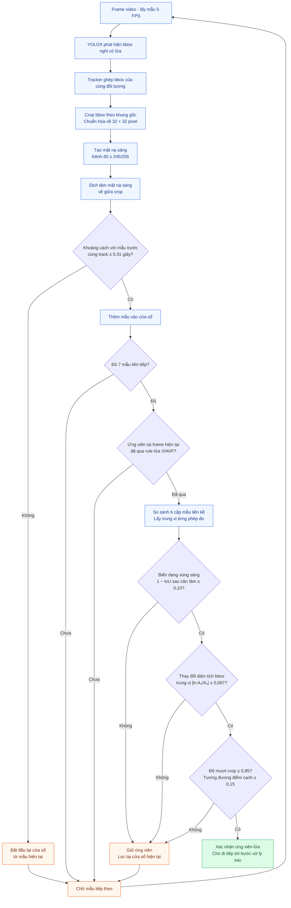

### 1. Thuật toán

Sử dụng rule trên VIAVF như bộ lọc đầu, sau đó mới là thuật toán bộ lọc đèn xe.

**Track** là chuỗi theo dõi cùng một đối tượng qua nhiều frame, được gán một ID riêng. Tracker ghép các bbox dựa trên độ chồng lấp và khoảng cách giữa các tâm. Mỗi track giữ lịch sử riêng để thuật toán so sánh đúng vùng sáng qua thời gian. Nếu mất chuỗi quan sát quá 0,31 giây, cửa sổ lấy mẫu của track được bắt đầu lại.

Lịch sử được thu thập từ khi có track. Bộ lọc chỉ xác nhận ứng viên tại frame đã qua rule VIAVF. Ứng viên cần đạt đồng thời cả ba phép đo và được đánh giá lại theo cửa sổ trượt ở các frame tiếp theo.

### 2. Kết quả kiểm thử

Kết quả dưới đây dùng **phiên bản cuối đã bổ sung đầy đủ ba phép đo**, trên hai nhóm video gốc `true` và `false`.

| Nhóm video | Số lượng | Kết quả thuật toán cuối |
|---|---:|---|
| `true` — có lửa thật | 14 | **14/14 clip** có ứng viên khoanh đúng vùng lửa và đi tiếp |
| `false` — đèn xe, vùng sáng phản xạ | 11 | **11/11 clip** dừng, không có ứng viên đi tiếp |

So với bộ lọc cũ, số clip báo nhầm được loại tăng từ **2/11 lên 11/11**. Thời điểm xác nhận trung vị của nhóm lửa thật tăng từ **2,2 lên 2,6 giây** tính từ đầu clip. Một clip chậm thêm **7 giây**, và một clip chỉ được xác nhận ở **giây 10,0**, cuối video.

Bộ 25 video này đã được dùng để chọn ngưỡng. Khi giữ riêng từng nhóm cảnh rồi chọn lại ngưỡng trên các nhóm còn lại, kết quả là **13/14 clip lửa thật được nhận và 8/11 clip âm được loại đúng**.

### 3. Kết luận và ưu nhược điểm

Phiên bản cuối nhận đủ lửa thật và loại đủ các clip báo nhầm trong bộ dùng để phát triển. Kết quả kiểm tra theo nhóm cảnh cho thấy thuật toán còn phụ thuộc vào dữ liệu chọn ngưỡng và cần được đối chiếu thêm trên các camera, điều kiện ánh sáng khác.

**Ưu điểm**

- Xử lý được các ca đèn pha, đèn hậu và đèn hắt lên tường trong bộ kiểm thử.
- Có thể giữ hoặc chặn vùng sáng khi mức biến dạng và co nở chưa đạt điều kiện xác nhận.
- Kiểm tra cả bbox nhỏ và bbox lớn sau rule VIAVF.
- Có điểm số và lý do cho từng quyết định, thuận tiện đối chiếu với video kết quả.

**Nhược điểm**

- Lửa nhỏ hoặc bị che có thể mất chuỗi mẫu, gây chậm hoặc bỏ sót.
- Các ngưỡng được thiết lập dựa trên thử nghiệm với bộ video được thu thập từ portal, hiệu quả trong thực tế cần được kiểm chứng thêm.
- Vùng sáng mạnh vẫn có thể vượt cả ba phép đo. Trong video cháy xe bổ sung, thuật toán nhận đúng ngọn lửa nhưng cũng nhận nhầm vùng cửa sáng.
- Độ nét, nền bên trong bbox và thay đổi phơi sáng có thể ảnh hưởng đến điểm số.
